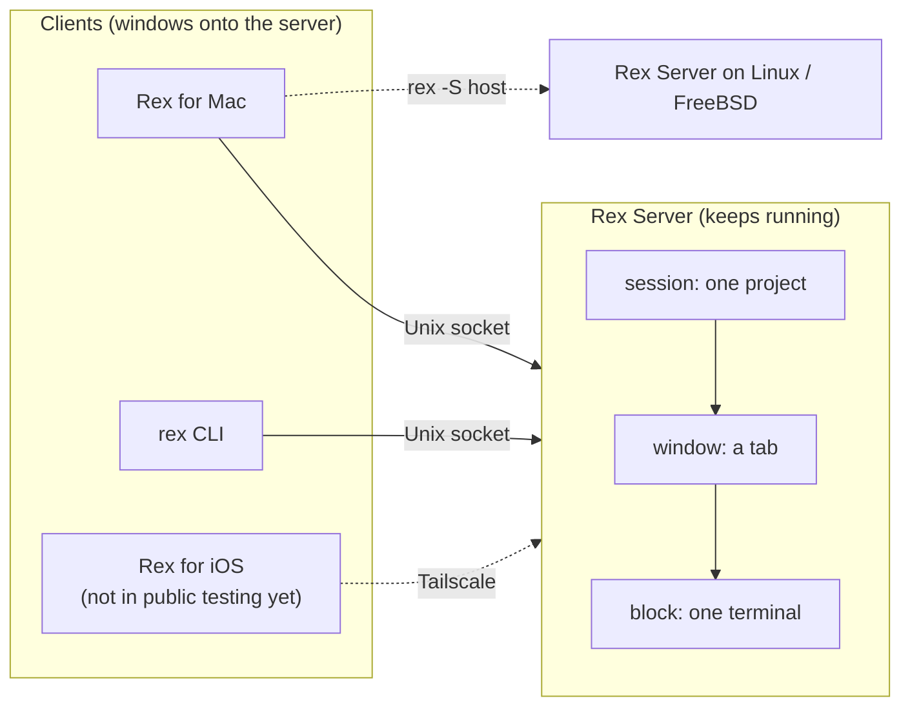
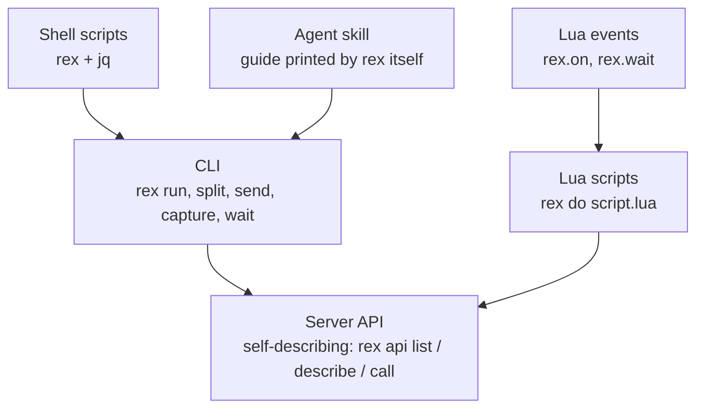
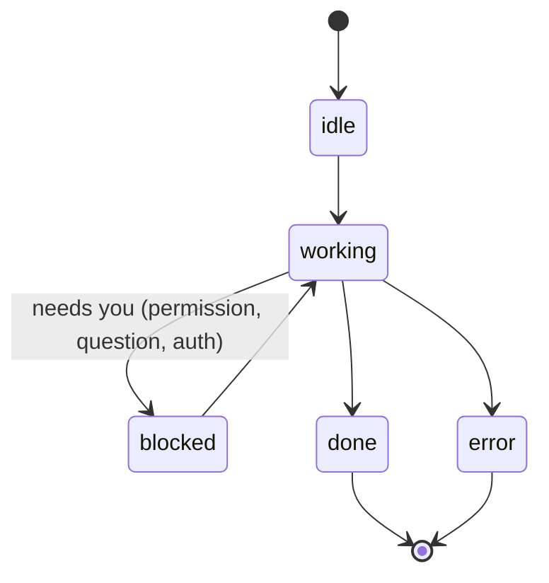

# Rex, in depth: what it brings and what to build with it

Notes from reading the whole [Rex documentation](https://www.superlogical.com/rex/docs/)
(beta, November 2026), starting from the
[Agents page](https://www.superlogical.com/rex/docs/automate/agent-skill), and
comparing it with the Ghostty + Herdr setup in [`../herdr/`](../herdr/).

Quotes are from the Rex docs. Anything marked *inference* or *to check* is not
stated there.

## The short version

Rex is a **server that owns your terminals**, with thin clients on top (the Mac
app, the `rex` CLI, an iOS app in the works). Three things make it matter for
agent work:

1. **Everything is addressable and scriptable.** Every session, tab and pane
   has a stable ID, and one self-describing server API drives the CLI, Lua and
   the agent skill alike.
2. **Agents get hands and eyes.** With the skill, Claude Code can open a pane,
   type into it, read its screen and wait for it to finish, without you
   relaying anything.
3. **Status is a protocol, not a plugin.** Programs report `working`,
   `blocked`, `done` or `error` themselves through an open escape sequence
   (OSC 7501), and Rex turns that into tab indicators, notifications and
   events.

Herdr is an agent dashboard that lives inside a terminal. Rex is the terminal,
the multiplexer and the automation bus in one, with agents as one kind of
program among others.

## 1. The mental model



| Term | Meaning | Herdr equivalent |
|---|---|---|
| **session** | "a group of related work, such as one project"; keeps running "whether or not anything is looking at it" | workspace |
| **window** | "a tab within a session. It holds a layout of blocks" | tab |
| **block** | "one application in a window. Today that means a terminal". "Pane" is the UI word | pane |
| **client** | "a program connected to the server, such as the app" | the attached TUI |
| **host** | another Rex server, reached with `-S` | SSH thin client |

Things to know about addressing, because every automation depends on it:

- IDs never change and are never reused (`block:01a10d99-…`). Labels are names
  you choose. In scripts, keep the ID.
- Every terminal gets `REX_SESSION`, `REX_BLOCK` and `REX_SERVER`, so a command
  run in a pane already knows where it is.
- A target (`-s`, `-w`, `-b`) is matched as full ID, then label, then position
  (`-w 2` is the second tab), then an ID suffix of 4+ characters. An ambiguous
  target changes nothing and exits with status 3.

## 2. The agent skill

`rex skill setup` (or **Install Rex for Agents** in the palette) installs two
things per agent:

| Piece | What it does | Why it is designed that way |
|---|---|---|
| **Skill** | Teaches the agent the `rex` commands and when to use them | "It reads its guide from the installed `rex`, so upgrading Rex updates what the agent knows without running setup again" |
| **Hook** | At session start, tells the agent it is in Rex and which session and terminal it is in | "so it doesn't spend time or tokens finding out" |

The docs are candid that a modern agent can discover the CLI alone; the skill
exists because "you'll use fewer tokens and take less time".

What it unlocks, in the docs' own examples:

| You say | The agent does |
|---|---|
| "Start the dev server in another tab and tell me when it's ready." | Starts it without taking focus, reads the tab until the server says it is listening |
| "Run the tests beside you and fix whatever fails." | Runs them in a split, waits, reads the failures from the screen |
| "Run `\dt` in the psql pane and tell me what's there." | Types into psql, presses Return, reads the result |
| "Close everything you opened." | Closes its own tabs and panes, leaves the rest |

How the agent decides *where* to act:

- "here", "beside you", or nothing: its own session and terminal
- "the focused pane", "the current tab": whatever has focus in the session you
  are viewing
- a name: the session, tab or pane with that label, which always wins

Details worth remembering:

- Supported: Claude Code and Codex (skill + hook), OpenCode and Pi (skill only).
  Any other agent can run `rex skill show` and follow the guide.
- The hook only runs at session start, and Claude Code runs no hooks until you
  trust the folder. If an agent "doesn't know it's in Rex", start a new session.
- `rex skill status` shows `current` / `outdated` / `missing` / `foreign` per
  agent. `--project` installs into a repo instead of your account.
  `--session-naming` lets agents name the session after their task.
- Asking the *app* to do something (switch session, change font size) needs
  **Remote Control** turned on in the app's settings.

## 3. Five ways to automate, one API underneath

"The CLI and Lua APIs all derive dynamically from the server API." That is the
design decision to remember: there is one surface, and it documents itself
(`rex api list`, `rex api describe`), so the docs "always match that server's
version".



| Surface | Reach for it when | Example from the docs |
|---|---|---|
| **CLI** | One-off commands, and what agents use | `rex send -s build -w 2 'make test'` |
| **Shell + jq** | Short linear glue | `block=$(rex split --json -- htop \| jq -r '.block_ids[0]')` |
| **Lua script** | "Anything beyond a few commands": one connection, no JSON parsing | `rex do -e 'return rex.call("session.list")'` |
| **Lua events** | Reacting every time something happens, or start-wait-act flows | `rex.wait("terminal.child_exited", { block_id = id }, 600)` |
| **Server API** | Methods the CLI does not wrap, or handing an agent the exact shape of a call | `rex api call -s work session.view` |

The verbs that matter most:

| Verb | Command | Note |
|---|---|---|
| Open | `rex new`, `rex run`, `rex split` | `--label`, `--focus=false`, `--keep-open`, `--ratio`, `--cwd` |
| Type | `rex send`, `rex send-key enter` | `send` does not press Enter for you |
| Read | `rex capture -b logs --trim` | Full-screen TUIs have no scrollback: you get the current screen only |
| Wait | `rex run --wait`, `rex wait --for 10m "$block"` | Exits with the command's own status |
| Watch | `rex events --json`, `rex.on(...)` | `terminal.bell`, `terminal.child_exited`, `terminal.program_status_changed` |
| Drive the app | `rex do pane.split direction=right` | Needs Remote Control |

The canonical pattern, straight from the docs:

```sh
#!/bin/sh
# Run a command in a split; if it fails, zoom the split.
block=$(rex split --keep-open --focus=false --json -- sh -c "${1:-make test}" |
  jq -r '.block_ids[0]')

if ! rex wait --for 10m "$block"; then
  rex zoom -b "$block" --on
  exit 1
fi
```

## 4. Program Status Protocol (OSC 7501)

This is the idea in Rex with the longest reach. A program prints one escape
sequence to say what it is doing:

```
ESC ] 7501 ; state=blocked:kind=permission:app=terraform:msg=<base64> ESC \
```



- **States:** `idle`, `working` (optional `progress`), `blocked` (with a `kind`
  and a `msg`), `done`, `error`.
- **Who reports:** "the program that knows its state reports it". No screen
  scraping, no per-tool plugin.
- **Lifetime:** `working` and `blocked` are dropped when the process exits or a
  new prompt appears; `done` and `error` stay.
- **Several records per terminal:** hierarchical ids such as `build/test`.
- **What Rex does with it:** tab spinners and blocked marks, session-picker
  indicators, an Activity sidebar, macOS notifications, a Dock badge, sounds,
  and the `terminal.program_status_changed` event for scripts.
- **It is open:** "a generic terminal protocol… no Superlogical-specific
  functionality or language", written spec-style (revision 0.4).

Any script of yours can join in with one line:

```sh
status() { printf '\e]7501;state=%s:msg=%s\e\\' "$1" "$(printf '%s' "$2" | base64 | tr -d '\n')"; }
status working "Archiving"; xcodebuild archive ... && status done "Archive OK" || status error "Archive failed"
```

*To check:* the docs do not say how Claude Code's own state reaches Rex (the
installed hook, or native OSC 7501). Run `rex events --json` next to an agent
and look at what arrives.

## 5. Rex vs Herdr

| | Herdr | Rex |
|---|---|---|
| **What it is** | A TUI multiplexer running *inside* a host terminal (Ghostty) | The terminal app, the server and the CLI together |
| **Built for** | Supervising coding agents | "All work": agents are one kind of program |
| **Agent status** | Per-agent integrations: a hook plus process and screen detection | A protocol any program can emit, with reasons and messages |
| **Extending it** | Plugins (manifest, build step, actions), TOML config | Lua: `init.lua` for keys and actions, scripts and event handlers at runtime |
| **API** | CLI + socket API | One self-describing server API behind the CLI, Lua and the skill |
| **Agent skill** | Yes: spawn, prompt, read, wait on agents in panes | Yes: same verbs, guide served by the binary so it never goes stale |
| **Keys** | Prefix key; Cmd chords need Ghostty to send raw bytes | Native shortcuts, sequences (`ctrl+b>c`) and modes in `init.lua` |
| **Remote** | Thin client over SSH | Servers on Linux/FreeBSD, Tailscale listeners, `rex -S host` |
| **Openness** | Open source | Closed beta via Discord; no telemetry, no account |
| **Maturity** | Pre-1.0, upgrades have broken the client/server protocol | Beta; remote auth is network-trust only for now |

What changes concretely for this setup:

- **Whole layers disappear.** No `\x02` byte keybinds in Ghostty, no OSC 12
  cursor workaround, no sidebar plugin to maintain, no workspace auto-numbering
  script. The palette, the activity view and the status marks are built in.
- **Custom code moves from plugins to scripts.** What took a Go plugin and a
  manifest in Herdr is a Lua function or a shell script here.
- **Status stops being agent-only.** A build, a deploy watcher or a test run
  can show the same `working` / `blocked` / `done` marks as an agent.

What Herdr still has over Rex today: it is open source, it runs on Windows, it
works over plain SSH and mosh from any terminal app, and it restores a layout
after a reboot (*to check* for Rex).

## 6. What I could build with it

Drawn from how I actually work: many short agent sessions started from the
phone, iOS apps whose Swift only compiles on the Mac, Python backends deployed
on push, and several agents in parallel on one repo.

| # | Build | The friction it removes | Rex pieces |
|---|---|---|---|
| 1 | **Mac build gate.** A script that checks out a pushed branch in a worktree and runs `xcodebuild build` + tests in a labelled pane | Cloud agents push Swift they cannot compile; the first real compile is after merge | `rex run --wait`, `rex capture`, OSC 7501 |
| 2 | **Watcher panes instead of poll loops.** `gh pr checks --watch`, deploy status, each in a background pane | Agents hand-roll `sleep` loops; deploys fail silently | `rex run --focus=false --label`, `rex wait --for` |
| 3 | **Worktree lifecycle action.** One action: new worktree, new tab, agent started with a brief. On merge: back to main, pull, close | "Back to main & pull" typed after every merge | `rex.action`, `rex new`, `rex send` |
| 4 | **Fan-out board.** One labelled pane per reviewer or verifier agent, plus a script printing "9/13 done, 2 blocked" | Losing track of parallel agents ("where are we?") | `program_status`, `rex.on("terminal.program_status_changed")` |
| 5 | **Supervised dev servers.** Metro, API and web in labelled background panes that agents read instead of restarting | Dev servers dying unnoticed; agents starting duplicates | `--label`, `--keep-open`, `rex capture`, `terminal.child_exited` |
| 6 | **Handoff without the clipboard.** Open a pane in another repo and type the brief into a fresh agent | Copying briefs between sessions by hand | `rex new --cwd`, `rex send` |
| 7 | **Blocked-agent pings.** A handler that notifies when any agent is `blocked`, with the question | Sessions stalled on "open a PR?" for hours | `rex.on`, `rex.exec`, notifications setting |

Sketch for #1 (untested, to adapt):

```sh
#!/bin/sh
# build-gate.sh <repo-dir> <branch> : compile a pushed branch, report the result
repo=$1; branch=$2; wt="$repo/../.gate-$(echo "$branch" | tr / -)"
git -C "$repo" fetch origin "$branch" && git -C "$repo" worktree add -f "$wt" "origin/$branch"

block=$(rex run --label "gate:$branch" --cwd "$wt" --keep-open --focus=false --json -- \
  sh -c 'xcodebuild -scheme App -destination "generic/platform=iOS Simulator" build 2>&1 | tail -200' |
  jq -r '.block_ids[0]')

if rex wait --for 20m "$block"; then echo "OK $branch"
else rex capture -b "$block" --trim | grep -E "error:" | head -40; exit 1
fi
```

Sketch for #7 (untested; check the payload shape with `rex events --json` first):

```lua
-- blocked.lua : run with `rex do blocked.lua --all`
rex.on("terminal.program_status_changed", function(ctx, ev)
  if ev.record and ev.record.state == "blocked" then
    local view = rex.session.view{}
    rex.exec{ "osascript", "-e", string.format(
      "display notification %q with title %q", ev.record.msg or "needs you", view.label) }
  end
end)
```

Suggested order: 2 and 5 first (an afternoon, pure CLI), then 1 (the biggest
payoff), then 3 and 7.

## 7. What to dig into next

| Topic | Why | Where |
|---|---|---|
| Command targets and IDs | Every script depends on them | Automate > The CLI |
| `rex.on` vs `rex.wait` | The two shapes of every automation | Automate > Lua Events |
| OSC 7501 spec | Make your own scripts first-class citizens | Build for Rex > Program Status Protocol |
| Custom actions | Turn scripts into palette entries and shortcuts | Customize > Custom Actions |
| `rex api describe` | The real reference, always current | Automate > Server API |
| Remote access | A Rex server on the VPS, reachable from Mac and phone | Server > Remote Access |
| Community MCP | Docs, changelog and Discord history for your agent | Beta > Community MCP |

## Limits to keep in mind

- **Beta.** The Mac app and Linux/FreeBSD servers are in testing. The iOS
  client exists but is not part of public testing yet.
- **Remote security is thin for now.** "Rex trusts a caller based only on how
  they connect today"; use Tailscale, never `--allow-anonymous` on an open
  network. "A connection to a server can do anything that server can."
- **Reading TUIs.** `rex capture` on a full-screen program returns the current
  screen only, so reading another agent's history means asking that agent.
- **Events.** `terminal.child_exited` fires for the pane's own program, not for
  each command typed in a shell. Use `rex run --wait -- cmd` for per-command
  results. Misspelled event names fail silently.
- **Config split.** `init.lua` holds keys and actions; themes, fonts and
  notifications live in the app's settings (see [`README.md`](README.md)).
- **`rex.on` does not work in `init.lua`.** Long-running handlers are separate
  scripts started with `rex do`.
